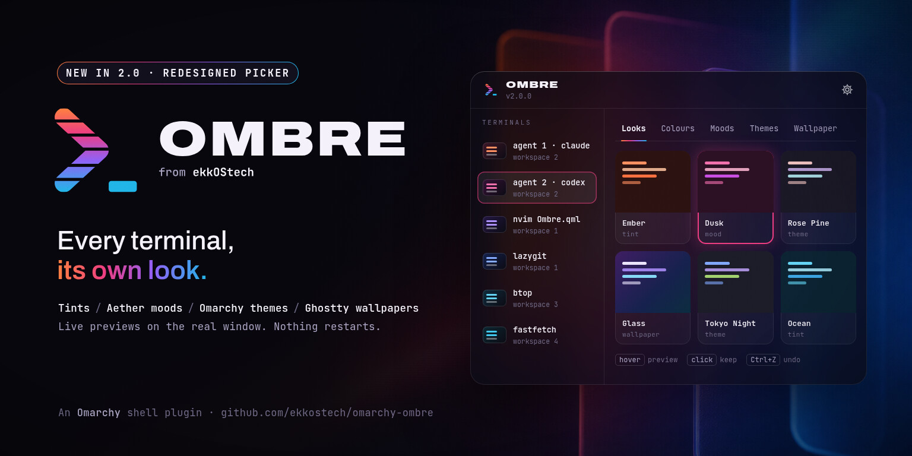
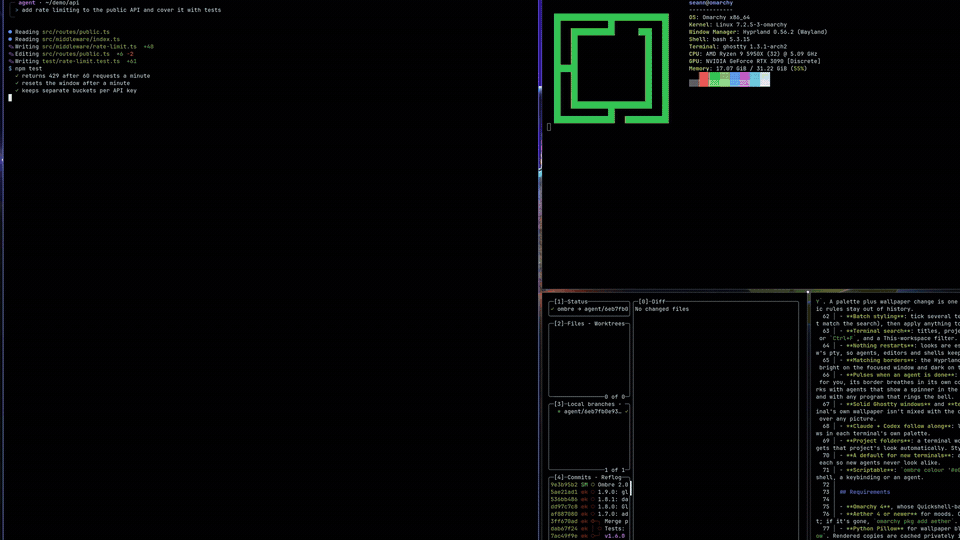
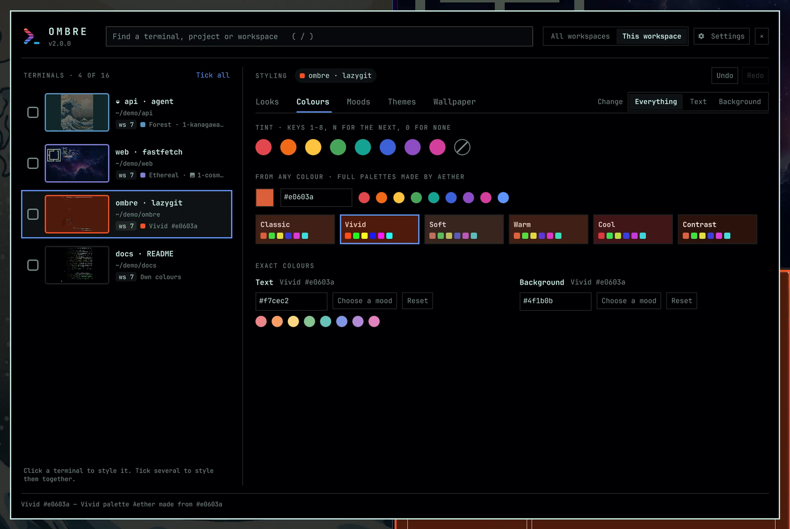
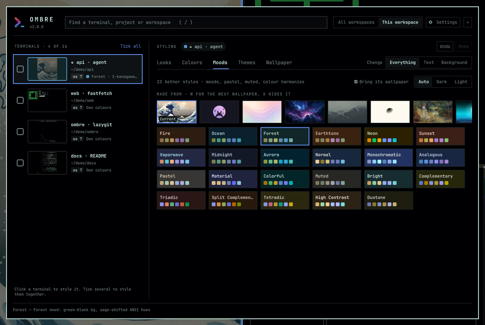
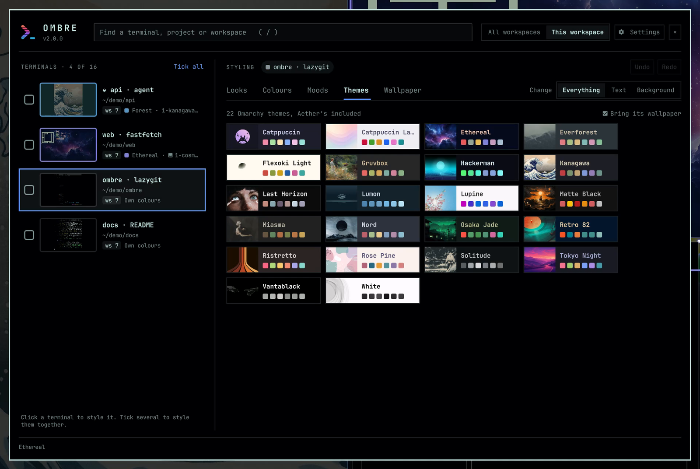
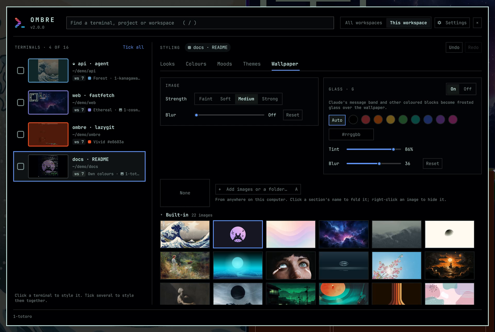
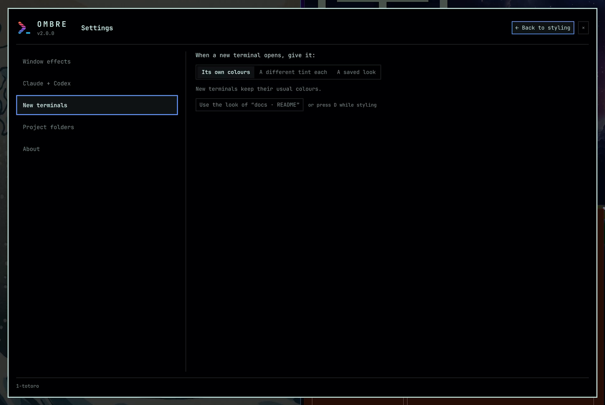

<p align="center">
  
</p>

# Ombre



*Om-bray.* An ombre shades one colour into another; this shades each of your Omarchy terminals its own way.

**Ombre** is an [Omarchy](https://omarchy.org) shell plugin from **ekkOStech** for telling terminal
windows apart, which helps when a handful of coding agents are going at once. Give each terminal its
own look while whatever runs inside keeps running: a tint, a full palette made from any colour, an
[Aether](https://github.com/bjarneo/aether) mood made from a wallpaper, a whole Omarchy theme or, in
Ghostty, its own wallpaper behind frosted glass. Its border matches, and pulses when its agent is done.



▶ **[Watch the trailer](https://github.com/ekkostech/omarchy-ombre/releases/download/v2.0.0/ombre-trailer.mp4)**

> **Wallpapers require Ghostty.** Tints, palettes, moods and themes work in foot, Alacritty, Kitty
> and Ghostty. A wallpaper behind the text is a Ghostty feature, so that part needs Ghostty
> (`omarchy install terminal ghostty`) and a one-time setup from Ombre's Settings.

## New in 2.0

A redesigned picker. 1.x grew into one long column with its tabs two thirds of the way down; 2.0 has
two columns and a home for settings.

- **Terminals on the left**: each one with a live thumbnail in its own colours, its project folder,
  workspace and look. Click one to style it, tick several to style them together.
- **Styling on the right**: who you're styling, with Undo and Redo, then **Looks**, **Colours**,
  **Moods**, **Themes** and **Wallpaper**. *Change: Everything / Text / Background* sits right beside them.
- **Palettes from any colour**: type or pick a colour and Aether makes six full 16-colour palettes from
  it: Classic, Vivid, Soft, Warm, Cool and Contrast.
- **Mood tone**: Auto follows your theme; Dark or Light makes every mood dark or light regardless.
- **Settings** (the gear, or `,`): window effects as switches with their keys, Claude + Codex app themes,
  new terminals, project folders, and an About page that says what's installed.











## Features

- **Live previews**: every terminal appears as a live thumbnail, on any workspace, in its current colours.
- **See which window you're styling**: the desktop dims around the selected terminal and outlines it with its name, on whichever monitor it's on. A terminal on another workspace is marked as off screen.
- **Try before you pick**: hovering a swatch, palette, mood or theme changes the actual window. Move away and it goes back.
- **Tints**: eight hues mixed into your theme's background, so text stays readable on light and dark themes. Keys `1`–`8`, `N` for the next, `0` for none.
- **Palettes from any colour**: Aether's `--palette-from-color` and `--adjust-palette` turn one colour into six complete palettes.
- **Aether moods**: Fire, Ocean, Forest, Neon, Sunset, Vaporwave, Midnight, Aurora and the rest of Aether's 23 modes, generated from your current wallpaper or any wallpaper in Aether's library, dark, light or following the theme.
- **Themes per terminal**: give one terminal Tokyo Night and another Gruvbox. Every installed Omarchy theme is listed with its wallpaper, including themes Aether made.
- **Wallpapers per terminal (Ghostty)**: a different wallpaper behind each Ghostty window, changed while it runs. A mood or theme can bring its wallpaper along; strength (Faint, Soft, Medium, Strong) keeps text readable and blur (Off to 40) softens the picture without touching the original.
- **Glass (Ghostty)**: blocks an app paints with its own background, such as Claude Code's message band, Codex's panels, a selection or a status bar, become frosted glass over the terminal's wallpaper, with the text kept sharp. Pick its colour (Auto follows each look), tint and blur.
- **Images from anywhere**: add any folder or image on the computer, including other drives. Folders show as foldable sections. Only real PNG and JPEG files are listed, checked by their contents. Nothing is copied or changed.
- **Saved looks and favourites**: save a named combination of text colours, background, wallpaper, strength and blur; star favourites; update, rename or remove them.
- **Undo and redo per terminal**: `Ctrl+Z`, `Ctrl+Shift+Z` or `Ctrl+Y`. A palette plus wallpaper change is one step; hover previews and automatic rules stay out of history.
- **Batch styling**: tick several terminals (or `Ctrl+A` for all that match the search), then apply anything to all of them.
- **Terminal search**: titles, project paths or workspaces, with `/` or `Ctrl+F`, and a This-workspace filter.
- **Nothing restarts**: looks are escape sequences sent to the window's pty, so agents, editors and shells keep running.
- **Matching borders**: the Hyprland border takes the look's accent, bright on the focused window and dark on the others.
- **Pulses when an agent is done**: when an agent finishes and waits for you, its border breathes in its own colour until you click into it. Works with agents that show a spinner in the window title (like Claude Code) and with any program that rings the bell.
- **Solid Ghostty windows** and **text shadow (Ghostty)**: so a terminal's own wallpaper isn't mixed with the desktop's, and text reads cleanly over any picture.
- **Claude + Codex follow along**: link once and their interface draws in each terminal's own palette.
- **Project folders**: a terminal working inside a project's folder gets that project's look automatically. Style one, press `F`, done.
- **A default for new terminals**: a saved look, or a different tint each so new agents never look alike.
- **Scriptable**: `ombre colour '#e0603a' vivid --title api` from a shell, a keybinding or an agent.

## Requirements

- **Omarchy 4**, whose Quickshell-based shell runs the plugin.
- **Aether 4 or newer** for moods. Omarchy installs Aether by default; if it's gone, `omarchy pkg add aether`.
- **Python Pillow** for wallpaper blur: `omarchy pkg add python-pillow`. Rendered copies are cached privately in `~/.cache/ombre/wallpaper-blur` (or `$XDG_CACHE_HOME/ombre/wallpaper-blur`).
- **Ghostty** for wallpapers: `omarchy install terminal ghostty`, then the one-time setup below.

Tints and themes need nothing else. Ombre checks for Aether and Ghostty
itself: the first-run notification and the picker's Moods and Wallpapers tabs
say what's missing and how to get it, and `ombre --check` lists it all.

## Install

```bash
omarchy plugin add https://github.com/ekkostech/omarchy-ombre.git --enable --yes
omarchy restart shell
```

The first time it loads, Ombre shows a notification about what it does
and whether wallpapers are ready. Click it to open the picker.

For wallpapers, use Ghostty and run the setup once. The **Set up Ghostty for
wallpapers** button in the picker's Wallpapers tab does the same as this:

```bash
omarchy install terminal ghostty        # if Ghostty isn't your terminal yet
ombre setup-ghostty
```

Then bind a key to open the picker. Add this to `~/.config/hypr/bindings.lua`:

```lua
o.bind("SUPER + ALT + T", "Ombre", "omarchy-shell shell toggle ekkostech.ombre '{}'")
```

## Using the picker

The picker has two columns. On the left are your terminals; the one you were in is selected when it
opens. On the right is what to give them: the chips at the top show who you're styling, then the tabs.

- **Looks**: your saved looks and favourites.
- **Colours**: the eight tints, six Aether palettes from any colour you type or pick, and exact text and background colours.
- **Moods**: Aether's styles made from a wallpaper (the strip picks which), dark, light or following your theme.
- **Themes**: every installed Omarchy theme, with its wallpaper.
- **Wallpaper** (Ghostty): strength, blur and glass, then None, your added folders and the built-in wallpapers.

*Change: Everything / Text / Background* decides which layer a palette, mood, theme or saved look
changes. On a Ghostty window, **Bring its wallpaper** makes a mood or theme bring its picture along.

Window effects, Claude + Codex app themes, what new terminals get, project folders and the About page
are in **Settings**: the gear at the top right, or `,`.

| Key | Action |
|-----|--------|
| `↑` / `↓` (`k` / `j`) | Move between terminals |
| `←` / `→`, `Tab` / `Shift+Tab` | Switch tabs |
| Click a terminal | Style just that one |
| Tick box, `Ctrl+click` or `Ctrl+Space` | Add or remove a terminal from the ones being styled |
| `Ctrl+A` | Tick every terminal that matches the search |
| Hover a swatch, palette, mood, theme or wallpaper | Preview it on the selected terminal |
| Click it | Keep it, on every terminal being styled |
| `Space` / `Shift+Space` | Next / previous look on the open tab |
| `1`–`8` | Tint: red, orange, amber, green, teal, blue, purple, pink |
| `N` | Next tint |
| `0` / `Backspace` | Back to the terminal's own colours (on Wallpaper: no wallpaper) |
| `/` or `Ctrl+F` | Search terminals |
| `Ctrl+S` | Name and save the selected terminal's look |
| `Ctrl+Z` / `Ctrl+Shift+Z` or `Ctrl+Y` | Undo / redo the selected terminal |
| `W` / `Shift+W` | Moods: next / previous wallpaper to make moods from |
| `X` | Moods: hide that wallpaper from the strip (right-click does too; files are untouched) |
| `H` | Moods and Wallpaper: show or hide the hidden ones |
| `A` | Wallpaper: add images or a folder from anywhere. In the browser: `↑`/`↓` move, `Enter` opens, `Backspace` goes up, `A` adds the folder, `/` types a path, `Esc` closes |
| `D` | Use the selected terminal's look for new terminals |
| `F` | Use the selected terminal's look for its project folder |
| `B` `P` `O` `T` `G` | Borders, pulse, solid Ghostty, text shadow, glass on/off |
| `,` | Settings (`Esc` goes back) |
| `Esc` / `Enter` | Close |

Everything works from the keyboard alone; the mouse is optional. Moods and palettes need Aether 4 or
newer. Without it, those tabs say how to get it, and tints, themes and wallpapers still work.

## Saved looks, history and selection

Save the selected terminal’s exact combination in Looks. Names are case-insensitive and can contain spaces (up to 64 characters). Star a saved look to put it in the favourites strip. **Update** replaces it with the selected terminal’s current combination; **Rename** preserves the look. Deleting requires a second confirmation click. Saved looks apply the chosen layer scope; a complete preset also restores its saved wallpaper and strength, including no wallpaper.

A plain click on a terminal returns to styling just that one. Tick boxes, Ctrl-click or `Ctrl+Space` build a batch; **Tick all** (`Ctrl+A`) ticks every terminal that matches the search and workspace filter. Changing a filter clears the ticks, and hidden terminals are never batch targets. Hover previews and undo/redo affect only the selected terminal. When a mixed batch contains terminals without wallpaper support, their colours still apply and Ombre reports how many wallpaper changes were skipped.

Undo history keeps up to 50 changes per terminal for the current shell session. Closing a terminal or restarting the shell clears its history; a reused process or pty never inherits it. Saved looks and favourites survive shell restarts in `~/.config/omarchy/ombre.json`, alongside existing settings and project rules. The library holds up to 200 named looks. Wallpapers are referenced by their local file paths.

## Scripting

```bash
ombre save "Deep Ocean"                 # capture the focused terminal
ombre look "Deep Ocean" --workspace 2   # apply a saved combination to a workspace
ombre look "Deep Ocean" --title Claude  # target matching agent terminals
ombre --saved                          # list saved looks and favourites
ombre saved favorite "Deep Ocean"      # toggle its star
ombre saved rename "Deep Ocean" "Ocean"
ombre undo --title Claude              # each matching terminal restores its own prior state
ombre redo                             # redo the focused terminal
```

Saved looks restore the complete combination through the CLI, independent of the picker’s layer scope. Existing `--all`, `--title`, `--pid` and `--address` targets remain available; `--workspace` matches an exact workspace name or number.

`bin/ombre` wraps the plugin's IPC. To use it, link it onto your `PATH`:

```bash
ln -s ~/.config/omarchy/plugins/ekkostech.ombre/bin/ombre ~/.local/bin/
```

```bash
ombre                      # open the picker
ombre red                  # tint the focused terminal
ombre next                 # cycle the focused terminal
ombre blue --title api     # every terminal whose title contains "api"
ombre '#203040' --pid 1234 # any hex color, by terminal pid
ombre reset --all          # clear everything
ombre mood:fire --title docs
ombre mood:ocean@/path/to/wallpaper.jpg
ombre theme:tokyo-night --pid 1234
ombre colour '#e0603a'      # a full Aether palette made from one colour
ombre colour '#e0603a' warm --title api   # or vivid, soft, cool, contrast
ombre tone light           # moods always light (or dark, or auto to follow the theme)
ombre blur 16              # blur the focused terminal's wallpaper (0-40; 0 is off)
ombre wallpaper ~/Wallpapers/forest.jpg --strength 0.15  # Ghostty
ombre wallpaper none
ombre --looks              # list moods, themes and wallpapers
ombre images add ~/Pictures/walls /mnt/photos/sunset.jpg   # PNG/JPEG files or folders, from anywhere
ombre images list          # added files and folders, and how many images each holds
ombre images remove ~/Pictures/walls   # the files stay where they are
ombre --check              # what's installed and what's missing
ombre borders off
ombre pulse off            # or on; 'pulse now --title api' to try it
ombre shadow on            # drop shadow under the text in Ghostty windows
ombre glass on             # frosted dark glass behind Claude's message band and other coloured blocks
ombre glass color purple   # or auto, smoke, any hue, or '#2a1040'
ombre glass tint 70        # 0-100: how much the colour covers the wallpaper
ombre glass blur 24        # 0-60: how soft the wallpaper behind the glass is
ombre glass                # show the glass settings; 'ombre glass reset' for the defaults
ombre solid off            # give Ghostty windows Omarchy's transparency back
ombre default auto         # new terminals each get a different tint
ombre default from         # new terminals copy the focused terminal's look
ombre default none
ombre project set ~/Projects/acme red --wallpaper ~/Wallpapers/Ombre/acme.png
ombre project from                 # the focused terminal's look, for its git root
ombre project list
ombre --list
```

Under the hood these call
`omarchy-shell shell call ekkostech.ombre apply '{"value":"red","target":"title:api"}'`.
The targets are `focused`, `title:TEXT`, `pid:N`, `address:HEX` and `all`. The
values are a hue name, `#rrggbb`, `next`, `reset`, `mood:NAME[@WALLPAPER]`,
`colour:#rrggbb[:classic|vivid|soft|warm|cool|contrast]`, `theme:NAME`,
`wallpaper:/path/to/image.jpg` or `wallpaper:none`.

## How it works

The plugin lists Hyprland's windows and finds each terminal's pty: the
controlling tty of the window process's children. It then writes standard
escape sequences to that pty, which the terminal treats like any program output
that changes its colors:

- `OSC 11` sets the background (a tint is only this),
- `OSC 4` sets the 16 ANSI colors, `OSC 10` the text and `OSC 12` the cursor,
- `OSC 104`, `110`, `111` and `112` put them back to the terminal's configuration.

Tints mix a hue into your theme's background, and they're re-mixed when you
switch themes. Moods come from `aether --extract-palette WALLPAPER
--extract-mode MODE` (with `--light-mode` for light ones). Palettes from a colour
come from `aether --palette-from-color HEX`, and their variants from
`aether --adjust-palette` (`bin/ombre-colour`). Themes map `colors.toml` onto the 16 colors the same way
Omarchy's foot template does.

Wallpapers use Ghostty's `background-image` option. Out of the box, Omarchy runs
every Ghostty window in one shared process, so a config change would hit all of
them. `ombre setup-ghostty` installs a small launcher
(`~/.local/bin/ombre-ghostty`) and points Ghostty's desktop entry at it.
Each new window then runs as its own process with an optional config file of
its own, `$XDG_RUNTIME_DIR/ombre/ghostty/PID.conf`. Setting a
wallpaper writes that file and sends the window `SIGUSR2`, which makes Ghostty
reload it. The plugin only signals processes it has confirmed are Ghostty
windows started by the launcher. Omarchy's theme switch reloads Ghostty the same
way, so wallpapers survive it. `ombre setup-ghostty --undo` reverts the
setup.

Solid windows use Hyprland's per-window `opacity` and `opacity_inactive` properties, set
to 1 on Ghostty windows only. Hyprland can't unset those properties, so before changing a
window Ombre records its current values (in `$XDG_RUNTIME_DIR/ombre/solid.json`) and puts
exactly those back when the setting is turned off.

The pulse watches Hyprland's window events. A title that switches from a
spinner (`◐ ◓ ◑ ◒`) to `✳` means an agent finished, and an `urgent` event means
the window rang the bell. Either starts the pulse unless the window already has
focus. Focusing the window, or the agent starting work again, stops it. Ghostty
reports bells by default; foot only with `[bell] urgent=yes` in `foot.ini`.

Looks are recorded per pty in `$XDG_RUNTIME_DIR/ombre/` so the picker
can show them. Each record is tied to the terminal's pid, so a reused pty starts
clean. The border setting is saved in `~/.config/omarchy/ombre.json`.

## Compatibility

- **Ghostty**: tested, including wallpapers, for windows opened after `setup-ghostty`. Ghostty windows opened before it share one process and are left out.
- **foot**: tested for tints, moods and themes. No wallpapers: foot can't draw images behind text.
- **Alacritty, Kitty**: should work for tints, moods and themes, since they also run one process per window and support the same escape codes. Not tested yet.
- **foot `--server` / `footclient`**: every window shares one process, so its windows can't be told apart. They're left out of the picker.
- A program that sets its own colors (a few TUIs do) overrides the look while it runs.
- Hyprland 0.56 draws only one color for a per-window border, so borders are solid rather than gradients.
- Moods made from a wallpaper show its colors in any terminal; the picture itself only appears in Ghostty.

## Development

```bash
node --test tests/          # unit tests, plus Qt-backed tests where a Wayland session is running
omarchy plugin validate .   # manifest check
```

Changes are listed in [CHANGELOG.md](CHANGELOG.md).

## Uninstall

```bash
ombre reset --all
ombre setup-ghostty --undo   # only if you set up wallpapers
omarchy plugin remove ekkostech.ombre
```

## License

MIT · Made by **ekkOStech**


## Session identity (2.1)

Ombre discovers ordinary terminal windows and local tmux panes, including
Omaguake 0.9.10 tabs backed by its isolated tmux server. Use `ombre sessions`
(or `ombre sessions api`) to open the searchable picker. Search matches labels,
commands, titles, folders, projects and workspaces. Arrow keys select results;
Enter in search, Ctrl+Enter in the picker, double-click, or **Jump ↗** switches
to the selected session. No shortcut is overwritten automatically.

Name the selected session in **Name this session…**, then press Enter. Clear it
and press Enter to remove the label. Window labels survive Ombre reloads while
the process lives. Pane labels and looks live on that specific tmux pane and
survive detaching, reconnecting, and shell reloads. They are not inherited by
new panes after the server exits. Existing saved project rules apply separately
to each pane using its current working directory; project rules survive reboot.

Pane colors use tmux's native pane-local background, foreground, cursor and
16-color palette options. Hover previews, saved looks, independent text/background
controls and reset are supported. Reset restores the pane's previous overrides
and inheritance. Neighboring panes and the host terminal palette are untouched.
Wallpapers, glass and compositor borders remain window capabilities.

Requires Python 3 and tmux 3.8 for the tested pane integration. Ordinary window
styling still works without tmux. Discovery checks owned sockets in
`$TMUX_TMPDIR/tmux-$UID` (normally `/tmp/tmux-$UID`) and `$TMUX` when supplied.
It does not connect to remote hosts or read terminal contents. Detached sessions
appear in the list, but must be attached before Jump can focus them. Omaguake
navigation uses its existing tab IPC and numeric tab order; manually renamed
Omaguake sessions and non-tmux fallback tabs are not supported. Select the desired
Omaguake row explicitly: the current upstream IPC does not expose its focused tab.

For reproducible project colors, style a session and press **F** to save its look
for that project folder, or use the existing `ombre project set` command.
